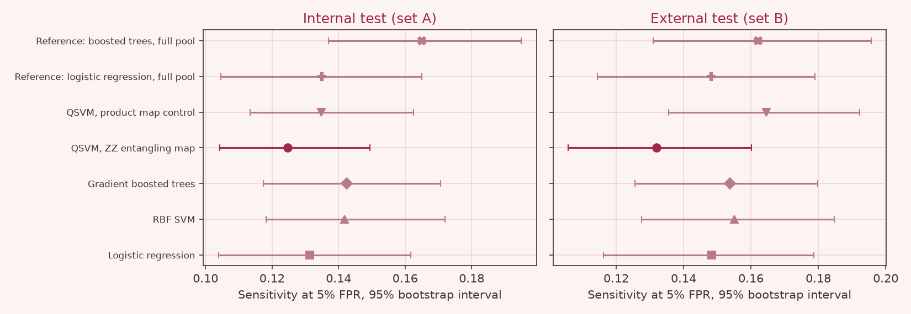
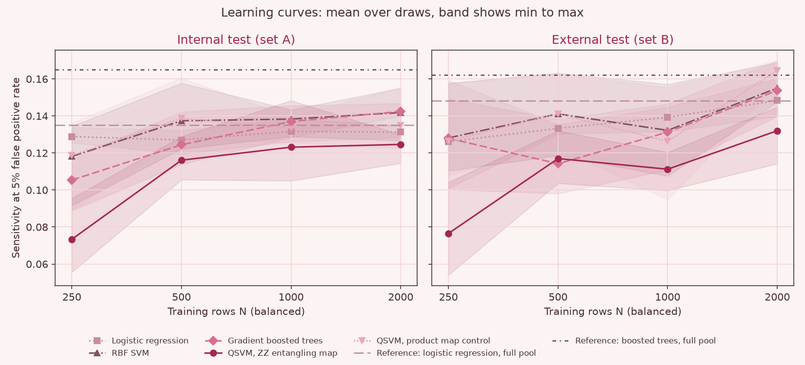
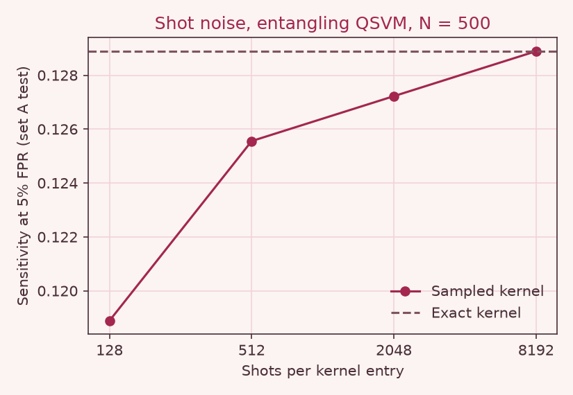
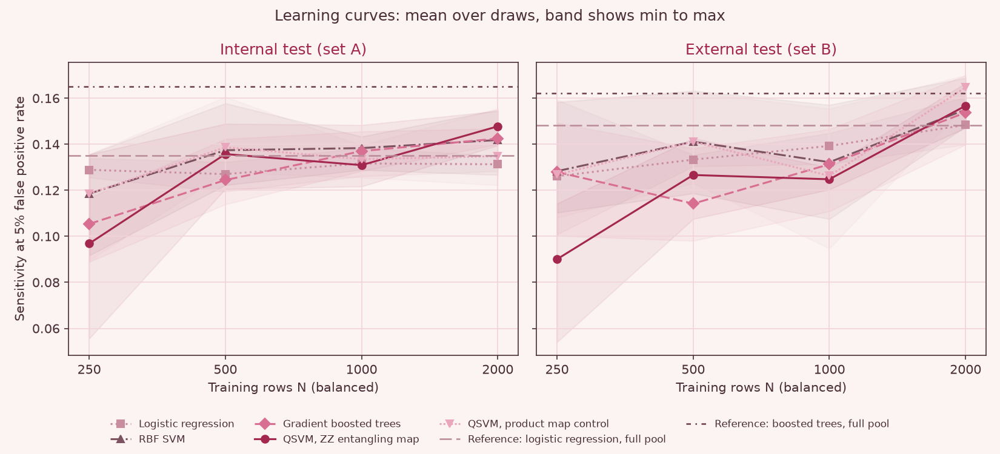
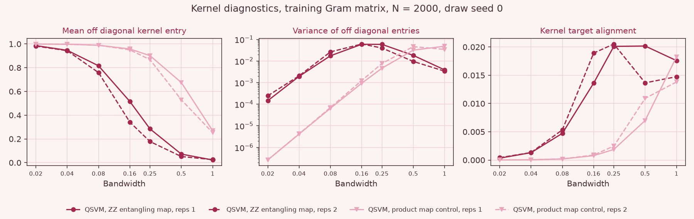

# SEPSIS-6Q: a quantum kernel early warning benchmark for sepsis in intensive care

Team Kanban, Qiskit Fall Fest 2026, Quantum Machine Learning track.

SEPSIS-6Q asks whether a compact quantum kernel support vector machine (QSVM) on eight qubits detects more hours before sepsis onset than strong classical models, when every model sees the same eight vital sign features, the same small set of labelled training rows and the same tuning budget. The data are the public PhysioNet/Computing in Cardiology Challenge 2019 records from two hospital systems: one system is used for training, validation and an internal test, and the other is held out as an external test. All quantum results come from exact statevector simulation on classical CPUs (a laptop for the primary run, a small two core Linux machine for the post hoc analyses and the clean timings, plus one binomial shot sampling study); nothing was run on quantum hardware.

<!-- BEGIN status -->
Status: final results from the full run on 20,336 set A files and 20,000 set B files.
<!-- END status -->

## At a glance

**Question.** Does a compact eight qubit quantum kernel SVM detect more pre onset sepsis hours in intensive care patients than strong classical models, when every model sees the same eight vital sign features, the same labelled training rows and the same tuning budget (18 configurations each in the prespecified run), judged by sensitivity at a fixed 5% false positive rate?

**Answer.** <!-- BEGIN glance_answer -->
At 2000 training rows the entangling QSVM reached a sensitivity of 0.125 on the internal test and 0.132 on the external test at a 5% false positive rate, against 0.142 and 0.154 for the best matched classical model (Gradient boosted trees), so the prespecified question is answered no; post hoc reruns with wider tuning grids changed the paired differences to +0.005 and +0.003 with wider bandwidth and gamma grids (section 7.8), and to +0.004 and +0.007 with every grid widened (section 7.8.1), so no improvement and no deficit can be claimed, and the deficit of the primary analysis on the external test (set B) did not persist.
<!-- END glance_answer -->

**Why the result is still informative.** The question, the metric and the training sizes were fixed before any model was trained, the comparison is matched, a product map control separates the effect of entanglement from the rest of the quantum model, and the quantum resources (circuits, timings, shot noise) are reported in full.

<!-- BEGIN glance_table -->
| Model | Internal test (set A): sensitivity at 5% FPR | Internal test AUROC | External test (set B): sensitivity at 5% FPR | External test AUROC |
|---|---|---|---|---|
| Logistic regression | 0.131 [0.104, 0.162] | 0.634 | 0.148 [0.116, 0.179] | 0.615 |
| RBF SVM | 0.142 [0.118, 0.172] | 0.659 | 0.155 [0.128, 0.185] | 0.655 |
| Gradient boosted trees | 0.142 [0.117, 0.171] | 0.659 | 0.154 [0.126, 0.180] | 0.651 |
| QSVM, ZZ entangling map | 0.125 [0.104, 0.149] | 0.658 | 0.132 [0.106, 0.160] | 0.646 |
| QSVM, product map (control) | 0.135 [0.113, 0.162] | 0.657 | 0.165 [0.136, 0.192] | 0.654 |
| QSVM, ZZ entangling map, wider bandwidth grid (post hoc, section 7.8) | 0.148 [0.122, 0.175] | 0.660 | 0.157 [0.130, 0.185] | 0.645 |
<!-- END glance_table -->

Sensitivity is the fraction of positive, pre onset rows that raise an alarm at a 5% false positive rate, shown with its 95% patient level bootstrap interval. AUROC is a point estimate. Values are means over 3 draws of N = 2000 balanced training rows; the detailed results start in section 7.



Figure: the prespecified grids and the primary run only. The post hoc runs with wider tuning grids are in sections 7.8 and 7.8.1.

## Detailed summary

<!-- BEGIN summary -->
Headline result at N = 2000 balanced training rows, mean over 3 draws, patient level bootstrap with 500 resamples. On the internal test (set A), the entangling QSVM reached a sensitivity of 0.125 [0.104, 0.149] at a 5% false positive rate, against 0.142 [0.117, 0.171] for the best matched classical model (Gradient boosted trees, chosen on validation data). The paired difference was -0.018 [-0.035, 0.002], so the QSVM was not distinguishable from it at this sample size (the 95% interval includes zero). On the external test (set B), the entangling QSVM reached a sensitivity of 0.132 [0.106, 0.160] at a 5% false positive rate, against 0.154 [0.126, 0.180] for the best matched classical model (Gradient boosted trees, chosen on validation data). The paired difference was -0.022 [-0.040, -0.004], so the QSVM was lower, and the 95% interval excludes zero. Against its own product map control on the internal test (set A), the entangling map was not distinguishable from it at this sample size (the 95% interval includes zero) (difference -0.010 [-0.023, 0.002]). Against its own product map control on the external test (set B), the entangling map was lower, and the 95% interval excludes zero (difference -0.032 [-0.045, -0.021]). The prespecified question is answered no: the quantum kernel did not detect more pre onset hours at the same false alarm rate. Post hoc checks, added after the primary results were seen and leaving the prespecified answer unchanged: with wider bandwidth and gamma grids (section 7.8) the entangling QSVM minus best matched classical difference was 0.005 [-0.012, 0.022] on the internal test and 0.003 [-0.013, 0.023] on the external test; with every grid widened (section 7.8.1) the entangling QSVM minus best matched classical difference was 0.004 [-0.013, 0.021] on the internal test and 0.007 [-0.009, 0.026] on the external test; in both cases no improvement and no deficit can be claimed, and the deficit of the primary analysis on the external test (set B) did not persist.
<!-- END summary -->

## 1. Prespecified question

This question, the eight features, the operating points, the training sizes and the headline training size were fixed in `src/sepsis6q/config.py`, committed before any model was trained, and were not changed after any result was seen. They are restated here unchanged.

> At the same false alarm rate, does a compact quantum kernel SVM detect more pre onset sepsis hours than the best classical model trained on the same features and the same training rows?

Primary metric: sensitivity (the fraction of positive, pre onset rows that raise an alarm) at exactly 5% false positive rate, read from the ROC curve of each test set. Headline training size: N = 2000 balanced rows, averaged over 3 random draws. The best matched classical model is chosen on validation data, not test data. An improvement is claimed only if the 95% patient level bootstrap interval of the paired difference excludes zero.

## 2. Problem and relevance

Sepsis is a dysregulated response to infection and a leading cause of death in intensive care. Treatment is time critical, so hospitals use early warning scores that raise an alarm before clinical recognition. Every early warning system trades missed cases against alarm fatigue: a system that alarms too often is ignored. This is why the comparison here is made at a fixed false alarm rate rather than by accuracy.

The intended outcome is a fair, reproducible answer to the question above, not a deployable tool. The setting deliberately mimics a hospital with few labelled sepsis cases, which is where a model with a different inductive bias could matter most. Local interest in machine learning early warning exists in the UAE: a cohort study at Cleveland Clinic Abu Dhabi with NYU Abu Dhabi built machine learning models for in hospital deterioration (Lashen et al., JMIR AI 2023). This project uses public ICU data from the United States, not UAE data. It is not validated for UAE use or for any clinical use, and it is a research prototype, not a medical device.

## 3. Data and preprocessing

### 3.1 Source

PhysioNet/Computing in Cardiology Challenge 2019 training data (Reyna et al., 2020; dataset DOI 10.13026/v64v-d857), sets A and B, which come from two separate hospital systems. Each patient file holds hourly rows with about 40 clinical columns and `SepsisLabel`. `scripts/download_data.py` fetches every file from the PhysioNet directory listing into `data/raw/setA/` and `data/raw/setB/`, which are git ignored. No raw or processed data are committed.

### 3.2 Label behaviour and the early warning task

In the challenge, `SepsisLabel` is 1 from six hours before clinical onset of sepsis onwards. The exploratory check in `sepsis6q.data.label_behaviour` confirms this per patient: the table below counts septic patients whose label is a single run of zeros followed by ones, patients whose label is already 1 in the first row, and the number of label 1 rows per septic patient.

What we found is reported in the table below and matches the documented behaviour: in every septic patient of both sets the label is a single run of zeros followed by a single run of ones, with no return to zero. The longest run of ones also shows that the published records of septic patients stop a few hours after onset, so most label 1 rows lie before onset. Some septic patients carry label 1 from their first row, which means that onset was within six hours of the start of their record; they are kept, and their positive rows are the rows before onset.

Task definition. Onset is the first label 1 row plus six hours. For each septic patient, rows at or after onset are removed, because an alarm there is no longer an early warning. Positive rows are the label 1 rows before onset (at most six per patient). Negative rows are all earlier rows of septic patients and all rows of non septic patients.

<!-- BEGIN data -->
| Set | Patients | Hourly rows | Septic patients | Label monotone (0 then 1) | Label 1 from first row | Label 1 rows per septic patient (min / median / max) | Task rows | Positive task rows | Row prevalence |
|---|---|---|---|---|---|---|---|---|---|
| Set A | 20336 | 790215 | 1790 | 1790 of 1790 | 203 | 6 / 10 / 10 | 783819 | 10740 | 1.37% |
| Set B | 20000 | 761995 | 1142 | 1142 of 1142 | 223 | 1 / 10 / 10 | 758026 | 6811 | 0.90% |

Set A patient split (all patients): 12202 training pool, 4067 validation, 4067 internal test.

| Partition | Patients | Septic patients | Rows | Positive rows | Row prevalence |
|---|---|---|---|---|---|
| Training pool (set A, 60%) | 12202 | 1074 | 471468 | 6444 | 1.37% |
| Validation subset (set A, 20% split) | 2272 | 200 | 87819 | 1200 | 1.37% |
| Internal test subset (set A, 20% split) | 3408 | 300 | 130441 | 1800 | 1.38% |
| External test subset (set B) | 5254 | 300 | 198929 | 1795 | 0.90% |
<!-- END data -->

### 3.3 Splits

All splits are by patient and seeded (seed 2026). Set A patients are split 60% training pool, 20% validation and 20% internal test, stratified by sepsis status. Set B, a different hospital system, is the external test. To keep runtime manageable, validation and both test sets are fixed random patient subsets, stratified so that the natural prevalence of septic patients is preserved: 200 septic patients for validation and 300 septic patients for each test set, plus the matching proportion of non septic patients. Validation and test rows stay at their natural prevalence.

Training rows for the matched comparison are drawn only from the training pool, in sizes N of 250, 500, 1000 and 2000, balanced 1:1 between positive and negative rows, with 3 random draws (seeds 0, 1, 2) per N. The same drawn rows go to every matched model.

### 3.4 Features (identical for every matched model)

Eight features were prespecified and never changed: the current values of HR, Resp, Temp, SBP, MAP and O2Sat, and the 6 hour change in HR and in Resp. Only past information is used. Vital signs are forward filled within a patient from past values only, with a carry limit of 12 hours. Remaining gaps, including trends in the first six hours, are imputed with medians of the training rows. Every feature is then scaled to [0, 1] with the minimum and maximum of the training rows, and validation and test values are clipped to that range. All transforms are fitted on the N training rows of each draw only. The quantum models multiply the scaled values by pi times a bandwidth parameter to obtain rotation angles.

`tests/test_data_pipeline.py` checks that features do not change when future rows are removed, that patient ids are disjoint across splits, that training draws come from the training pool only, and that transforms fitted on training rows are unaffected by changes to test rows.

## 4. Classical baselines

Matched models, all on the same eight features, the same N rows and the same preprocessing:

* Logistic regression (scikit-learn `LogisticRegression`).
* Support vector machine with an RBF kernel (scikit-learn `SVC`), tuning C and gamma. This is the closest classical counterpart of the QSVM: the same SVM solver with a classical kernel.
* Gradient boosted trees (scikit-learn `HistGradientBoostingClassifier`, small grid, no early stopping).

Tuning protocol, identical for every matched model including the QSVMs: patient grouped 3 fold cross validation on the N training rows (`GroupKFold`, so no patient contributes rows to both sides of a fold), selecting the configuration with the highest mean held out AUROC. Grid sizes are comparable across models:

<!-- BEGIN grids -->
| Model | Grid | Configurations |
|---|---|---|
| Logistic regression | C in [0.001, 0.01, 0.1, 1.0, 10.0, 100.0] | 6 |
| RBF SVM | C in [0.1, 1.0, 10.0]; gamma in [0.25, 0.5, 1.0, 2.0, 4.0, 8.0] | 18 |
| Gradient boosted trees | learning_rate in [0.03, 0.1, 0.3]; max_depth in [2, 3, 4]; max_iter in [100, 300] | 18 |
| QSVM, ZZ entangling map | C in [0.1, 1.0, 10.0]; bandwidth in [0.25, 0.5, 1.0]; reps in [1, 2] | 18 |
| QSVM, product map (control) | C in [0.1, 1.0, 10.0]; bandwidth in [0.25, 0.5, 1.0]; reps in [1, 2] | 18 |
<!-- END grids -->

Reference models (context only, not a fair competitor because they see far more labelled rows): logistic regression with balanced class weights and gradient boosted trees (learning rate 0.1, depth 4, 300 iterations), both trained on every row of the training pool with the same eight features, at natural prevalence, with fixed configurations and no tuning. A reference with all raw columns and missingness indicators, outside the matched comparison, is reported in section 7.9.

Credit: the task and data come from the PhysioNet/CinC Challenge 2019 (Reyna et al., 2020). The classical models are standard scikit-learn implementations (Pedregosa et al., 2011). Our classical models are deliberately restricted to the same eight features as the quantum model so that the comparison is fair; they are not a reproduction of the challenge entries, which used many more variables.

## 5. Quantum approach

### 5.1 Feature map and kernel

Each of the eight scaled features is encoded on one qubit as an angle x_i = b pi u_i, where u_i is in [0, 1] and b is a tuned bandwidth. One repetition of the entangling map is a Hadamard gate on every qubit, a phase gate P(2 x_i) on every qubit, and for each neighbouring pair (i, i+1) on a line the block CX, P(2 (pi minus x_i)(pi minus x_{i+1})), CX. This is the ZZFeatureMap construction of Havlicek et al. (2019) with linear entanglement, and the repetition count is tuned. The kernel is the state fidelity k(x, y) = |<psi(x)|psi(y)>|^2, which on hardware would be estimated by the compute uncompute circuit U(x) followed by the inverse of U(y), as the probability of measuring all zeros. The SVM is scikit-learn `SVC` with this precomputed kernel.

Control: the same QSVM with a product (non entangling) map, which keeps the Hadamard and single qubit phase gates and drops the pairwise blocks. It has the same grid as the entangling QSVM. If the entangling map does not beat the product map, the data do not support a claim that entanglement matters.

Tuning C, the bandwidth b and the repetition count is the fair counterpart of tuning C and gamma for the RBF SVM.

### 5.2 Implementation

Qiskit is the reference definition of the map (`sepsis6q.quantum.feature_map_circuit`). For speed, `sepsis6q.quantum.statevectors` is a batched numpy statevector simulator of the same map: since each repetition is a Hadamard layer followed by a diagonal phase, the state is computed with one product by the 256 by 256 Walsh Hadamard matrix and one elementwise phase per repetition. `tests/test_quantum.py` asserts that the numpy states equal Qiskit `Statevector` results to 1e-9 for random inputs, repetition counts 1 to 3 and both maps, and that the kernel equals the kernel of Qiskit's library `zz_feature_map` with linear entanglement. States are computed once per row, the training Gram matrix is one matrix product, and test decision values are computed in chunks against the support vectors only, never storing a full test by train matrix. Test overlaps use single precision complex arithmetic, which changes kernel values by about 1e-7; the training Gram matrix is computed in double precision.

### 5.3 Hypothesis, limitation addressed and what is not claimed

Hypothesis: the entangling map encodes pairwise interactions between neighbouring vital signs (for example heart rate with respiratory rate, blood pressure with mean arterial pressure) as phases, which might give a useful inductive bias when labelled sepsis cases are scarce. The classical limitation it addresses is sample efficiency in the small data setting of a single hospital, not computational cost.

At eight qubits this kernel is easy to simulate classically: a state has 256 amplitudes and the whole study runs on a CPU. No computational speedup is claimed, and none is possible at this size. Any advantage under test is about inductive bias and sample efficiency.

## 6. Evaluation protocol

Operating points were fixed before looking at test data.

* Model comparison at equal false alarm rate (primary): sensitivity at exactly 5% false positive rate, read from each test set's ROC curve with linear interpolation between ROC points.
* Deployment style: the threshold is chosen on the validation set at 95% and at 90% specificity and then applied unchanged to each test set; the realised false alarm rate on the test set is reported next to sensitivity.
* AUROC, and AUPRC (average precision) with its prevalence baseline.
* Patient level detection at the deployment thresholds: the fraction of septic patients with at least one alarm in their label 1 window before onset, and false alarms per 100 non septic patient days (each row is one hour).
* Uncertainty: patient level bootstrap with 500 resamples of the test patients for every headline metric and for the paired differences. In each resample the metric of a model is the mean over its 3 training draws, and the same resampled patients are used for every model, so differences are paired.
* Learning curves: the primary metric against N for all matched models, mean and spread over draws, with the full pool reference models as horizontal lines.

Metric code is tested against scikit-learn (`tests/test_metrics.py`), including weighted cases used by the bootstrap.

## 7. Results

All tables and figures in this section are generated by `scripts/render_readme_tables.py` from the files in `results/`.

### 7.1 Headline comparison at N = 2000

<!-- BEGIN headline -->
| Test set | Model | Sensitivity at 5% FPR | AUROC | AUPRC | AUPRC baseline (prevalence) |
|---|---|---|---|---|---|
| Internal test (set A) | Logistic regression | 0.131 [0.104, 0.162] | 0.634 [0.609, 0.661] | 0.025 [0.021, 0.031] | 0.014 |
| Internal test (set A) | RBF SVM | 0.142 [0.118, 0.172] | 0.659 [0.635, 0.685] | 0.027 [0.023, 0.032] | 0.014 |
| Internal test (set A) | Gradient boosted trees | 0.142 [0.117, 0.171] | 0.659 [0.634, 0.684] | 0.027 [0.023, 0.032] | 0.014 |
| Internal test (set A) | QSVM, ZZ entangling map | 0.125 [0.104, 0.149] | 0.658 [0.634, 0.685] | 0.026 [0.022, 0.031] | 0.014 |
| Internal test (set A) | QSVM, product map (control) | 0.135 [0.113, 0.162] | 0.657 [0.633, 0.683] | 0.026 [0.022, 0.031] | 0.014 |
| Internal test (set A) | Reference: logistic regression, full pool | 0.135 [0.105, 0.165] | 0.645 [0.620, 0.675] | 0.026 [0.021, 0.033] | 0.014 |
| Internal test (set A) | Reference: boosted trees, full pool | 0.165 [0.137, 0.195] | 0.678 [0.653, 0.703] | 0.031 [0.026, 0.038] | 0.014 |
| External test (set B) | Logistic regression | 0.148 [0.116, 0.179] | 0.615 [0.588, 0.645] | 0.018 [0.015, 0.023] | 0.009 |
| External test (set B) | RBF SVM | 0.155 [0.128, 0.185] | 0.655 [0.628, 0.681] | 0.019 [0.016, 0.023] | 0.009 |
| External test (set B) | Gradient boosted trees | 0.154 [0.126, 0.180] | 0.651 [0.626, 0.680] | 0.019 [0.016, 0.024] | 0.009 |
| External test (set B) | QSVM, ZZ entangling map | 0.132 [0.106, 0.160] | 0.646 [0.620, 0.671] | 0.017 [0.015, 0.021] | 0.009 |
| External test (set B) | QSVM, product map (control) | 0.165 [0.136, 0.192] | 0.654 [0.627, 0.680] | 0.020 [0.016, 0.024] | 0.009 |
| External test (set B) | Reference: logistic regression, full pool | 0.148 [0.114, 0.179] | 0.614 [0.584, 0.646] | 0.018 [0.015, 0.023] | 0.009 |
| External test (set B) | Reference: boosted trees, full pool | 0.162 [0.131, 0.196] | 0.642 [0.615, 0.666] | 0.019 [0.015, 0.022] | 0.009 |
<!-- END headline -->

Paired differences (same bootstrap resamples):

<!-- BEGIN paired -->
| Test set | Difference | Sensitivity at 5% FPR | AUROC | AUPRC |
|---|---|---|---|---|
| Internal test (set A) | QSVM, ZZ entangling map minus Gradient boosted trees | -0.018 [-0.035, 0.002] | -0.001 [-0.011, 0.009] | -0.001 [-0.003, 0.001] |
| Internal test (set A) | QSVM, ZZ entangling map minus QSVM, product map (control) | -0.010 [-0.023, 0.002] | 0.001 [-0.005, 0.007] | -0.000 [-0.002, 0.001] |
| External test (set B) | QSVM, ZZ entangling map minus Gradient boosted trees | -0.022 [-0.040, -0.004] | -0.005 [-0.017, 0.006] | -0.002 [-0.005, 0.000] |
| External test (set B) | QSVM, ZZ entangling map minus QSVM, product map (control) | -0.032 [-0.045, -0.021] | -0.007 [-0.014, 0.000] | -0.003 [-0.005, -0.001] |
<!-- END paired -->


### 7.2 Learning curves



<!-- BEGIN learning -->
| Test set | Model | N = 250 | N = 500 | N = 1000 | N = 2000 |
|---|---|---|---|---|---|
| Internal test (set A) | Logistic regression | 0.129 ± 0.004 | 0.127 ± 0.005 | 0.132 ± 0.005 | 0.131 ± 0.003 |
| Internal test (set A) | RBF SVM | 0.118 ± 0.019 | 0.137 ± 0.015 | 0.138 ± 0.007 | 0.142 ± 0.012 |
| Internal test (set A) | Gradient boosted trees | 0.105 ± 0.012 | 0.124 ± 0.013 | 0.137 ± 0.007 | 0.142 ± 0.003 |
| Internal test (set A) | QSVM, ZZ entangling map | 0.073 ± 0.017 | 0.116 ± 0.010 | 0.123 ± 0.018 | 0.125 ± 0.007 |
| Internal test (set A) | QSVM, product map (control) | 0.119 ± 0.021 | 0.139 ± 0.015 | 0.134 ± 0.006 | 0.135 ± 0.015 |
| External test (set B) | Logistic regression | 0.126 ± 0.025 | 0.133 ± 0.002 | 0.139 ± 0.006 | 0.148 ± 0.009 |
| External test (set B) | RBF SVM | 0.128 ± 0.021 | 0.141 ± 0.018 | 0.132 ± 0.020 | 0.155 ± 0.010 |
| External test (set B) | Gradient boosted trees | 0.128 ± 0.021 | 0.114 ± 0.017 | 0.131 ± 0.015 | 0.154 ± 0.012 |
| External test (set B) | QSVM, ZZ entangling map | 0.077 ± 0.021 | 0.117 ± 0.012 | 0.111 ± 0.009 | 0.132 ± 0.013 |
| External test (set B) | QSVM, product map (control) | 0.126 ± 0.022 | 0.141 ± 0.016 | 0.126 ± 0.025 | 0.165 ± 0.005 |

Values are mean ± standard deviation over the draw seeds.
<!-- END learning -->

### 7.3 Deployment style operating points at N = 2000

Thresholds chosen on validation data, mean over the 3 draws.

<!-- BEGIN deployment -->
| Test set | Model | Validation specificity target | Realised false alarm rate | Row sensitivity | Septic patients detected | False alarms per 100 non septic patient days |
|---|---|---|---|---|---|---|
| Internal test (set A) | Logistic regression | 95% | 0.056 | 0.142 | 0.281 | 118.4 |
| Internal test (set A) | Logistic regression | 90% | 0.105 | 0.234 | 0.436 | 228.7 |
| Internal test (set A) | RBF SVM | 95% | 0.053 | 0.147 | 0.340 | 111.2 |
| Internal test (set A) | RBF SVM | 90% | 0.104 | 0.250 | 0.490 | 222.3 |
| Internal test (set A) | Gradient boosted trees | 95% | 0.052 | 0.146 | 0.342 | 109.9 |
| Internal test (set A) | Gradient boosted trees | 90% | 0.102 | 0.243 | 0.489 | 221.7 |
| Internal test (set A) | QSVM, ZZ entangling map | 95% | 0.052 | 0.129 | 0.332 | 109.3 |
| Internal test (set A) | QSVM, ZZ entangling map | 90% | 0.102 | 0.244 | 0.480 | 218.5 |
| Internal test (set A) | QSVM, product map (control) | 95% | 0.053 | 0.142 | 0.329 | 111.8 |
| Internal test (set A) | QSVM, product map (control) | 90% | 0.103 | 0.245 | 0.487 | 222.7 |
| Internal test (set A) | Reference: logistic regression, full pool | 95% | 0.055 | 0.142 | 0.270 | 115.1 |
| Internal test (set A) | Reference: logistic regression, full pool | 90% | 0.103 | 0.237 | 0.443 | 222.5 |
| Internal test (set A) | Reference: boosted trees, full pool | 95% | 0.049 | 0.163 | 0.427 | 101.1 |
| Internal test (set A) | Reference: boosted trees, full pool | 90% | 0.098 | 0.280 | 0.590 | 204.3 |
| External test (set B) | Logistic regression | 95% | 0.039 | 0.130 | 0.253 | 87.5 |
| External test (set B) | Logistic regression | 90% | 0.082 | 0.199 | 0.341 | 186.4 |
| External test (set B) | RBF SVM | 95% | 0.041 | 0.134 | 0.306 | 88.7 |
| External test (set B) | RBF SVM | 90% | 0.083 | 0.225 | 0.424 | 184.3 |
| External test (set B) | Gradient boosted trees | 95% | 0.036 | 0.117 | 0.261 | 77.9 |
| External test (set B) | Gradient boosted trees | 90% | 0.076 | 0.209 | 0.394 | 169.6 |
| External test (set B) | QSVM, ZZ entangling map | 95% | 0.036 | 0.097 | 0.238 | 80.4 |
| External test (set B) | QSVM, ZZ entangling map | 90% | 0.074 | 0.189 | 0.379 | 167.5 |
| External test (set B) | QSVM, product map (control) | 95% | 0.038 | 0.134 | 0.281 | 82.5 |
| External test (set B) | QSVM, product map (control) | 90% | 0.076 | 0.219 | 0.412 | 169.0 |
| External test (set B) | Reference: logistic regression, full pool | 95% | 0.034 | 0.108 | 0.197 | 73.4 |
| External test (set B) | Reference: logistic regression, full pool | 90% | 0.070 | 0.184 | 0.333 | 159.3 |
| External test (set B) | Reference: boosted trees, full pool | 95% | 0.029 | 0.113 | 0.273 | 61.8 |
| External test (set B) | Reference: boosted trees, full pool | 90% | 0.061 | 0.189 | 0.447 | 134.3 |
<!-- END deployment -->

### 7.4 Selected configurations at N = 2000

<!-- BEGIN params -->
| Model | Selected configuration per draw | Mean best CV AUROC |
|---|---|---|
| Logistic regression | seed 0: {"C": 1.0}; seed 1: {"C": 10.0}; seed 2: {"C": 0.1} | 0.624 |
| RBF SVM | seed 0: {"C": 10.0, "gamma": 1.0}; seed 1: {"C": 10.0, "gamma": 2.0}; seed 2: {"C": 1.0, "gamma": 4.0} | 0.640 |
| Gradient boosted trees | seed 0: {"learning_rate": 0.03, "max_depth": 3, "max_iter": 100}; seed 1: {"learning_rate": 0.03, "max_depth": 2, "max_iter": 100}; seed 2: {"learning_rate": 0.03, "max_depth": 2, "max_iter": 100} | 0.639 |
| QSVM, ZZ entangling map | seed 0: {"C": 0.1, "bandwidth": 0.25, "reps": 1}; seed 1: {"C": 1.0, "bandwidth": 0.25, "reps": 1}; seed 2: {"C": 0.1, "bandwidth": 0.25, "reps": 1} | 0.634 |
| QSVM, product map (control) | seed 0: {"C": 10.0, "bandwidth": 0.25, "reps": 2}; seed 1: {"C": 10.0, "bandwidth": 0.5, "reps": 1}; seed 2: {"C": 0.1, "bandwidth": 1.0, "reps": 2} | 0.641 |
<!-- END params -->

### 7.5 Quantum resources and efficiency

Circuit counts after transpiling to the basis {rz, sx, x, cx} with linear qubit connectivity (Qiskit `transpile`, optimisation level 1). The kernel circuit is the compute uncompute circuit U(x) followed by the inverse of U(y), with measurement.

<!-- BEGIN resources -->
| Map | Repetitions | Circuit | Qubits | Depth | Two qubit gates (CX) | Total gates |
|---|---|---|---|---|---|---|
| ZZ linear | 1 | feature map | 8 | 25 | 14 | 53 |
| ZZ linear | 1 | kernel circuit | 8 | 49 | 26 | 104 |
| ZZ linear | 2 | feature map | 8 | 35 | 28 | 106 |
| ZZ linear | 2 | kernel circuit | 8 | 69 | 54 | 210 |
| product | 1 | feature map | 8 | 4 | 0 | 32 |
| product | 1 | kernel circuit | 8 | 9 | 0 | 64 |
| product | 2 | feature map | 8 | 8 | 0 | 64 |
| product | 2 | kernel circuit | 8 | 17 | 0 | 128 |
<!-- END resources -->

Timings (mean over draws) and the number of distinct circuits each estimator would need on hardware. With exact states, one state per training and evaluation row suffices. A sampled pairwise estimator needs one circuit per training pair, N(N minus 1)/2, plus one per evaluation row and training row pair. All quantum timings are classical simulation times.

<!-- BEGIN efficiency -->
| Model | N | Tuning time (s) | Final fit time (s) | Prediction time per 1000 rows (ms) | Support vectors | Circuits, exact states (N plus evaluation rows) | Circuits, sampled pairwise estimator |
|---|---|---|---|---|---|---|---|
| Gradient boosted trees | 250 | 14.6 | 0.32 | 3.38 |  |  |  |
| Logistic regression | 250 | 0.4 | 0.01 | 0.04 |  |  |  |
| QSVM, product map (control) | 250 | 0.8 | 0.02 | 49.34 | 218 | 417,439 | 104,328,375 |
| QSVM, ZZ entangling map | 250 | 0.8 | 0.02 | 53.84 | 232 | 417,439 | 104,328,375 |
| RBF SVM | 250 | 0.7 | 0.01 | 11.35 | 219 |  |  |
| Gradient boosted trees | 500 | 16.8 | 0.46 | 3.73 |  |  |  |
| Logistic regression | 500 | 0.4 | 0.01 | 0.04 |  |  |  |
| QSVM, product map (control) | 500 | 0.8 | 0.05 | 46.20 | 425 | 417,689 | 208,719,250 |
| QSVM, ZZ entangling map | 500 | 0.9 | 0.03 | 43.72 | 442 | 417,689 | 208,719,250 |
| RBF SVM | 500 | 1.0 | 0.02 | 17.71 | 422 |  |  |
| Gradient boosted trees | 1000 | 10.9 | 0.18 | 1.97 |  |  |  |
| Logistic regression | 1000 | 0.3 | 0.01 | 0.02 |  |  |  |
| QSVM, product map (control) | 1000 | 1.5 | 0.10 | 38.58 | 832 | 418,189 | 417,688,500 |
| QSVM, ZZ entangling map | 1000 | 1.8 | 0.13 | 36.34 | 854 | 418,189 | 417,688,500 |
| RBF SVM | 1000 | 1.9 | 0.05 | 20.61 | 827 |  |  |
| Gradient boosted trees | 2000 | 15.0 | 0.10 | 0.96 |  |  |  |
| Logistic regression | 2000 | 0.4 | 0.01 | 0.04 |  |  |  |
| QSVM, product map (control) | 2000 | 6.7 | 0.37 | 79.10 | 1721 | 419,189 | 836,377,000 |
| QSVM, ZZ entangling map | 2000 | 6.8 | 0.34 | 68.58 | 1739 | 419,189 | 836,377,000 |
| RBF SVM | 2000 | 7.7 | 0.26 | 55.22 | 1690 |  |  |

Evaluation rows per fitted model (validation plus both test subsets): 417,189.
<!-- END efficiency -->

Clean timing run. The timings above were taken on the shared laptop, and the runs at the two smallest N overlapped with another process. `scripts/measure_timings.py` therefore repeated tuning, the final fit and prediction for every matched model, training size and draw (primary grids, same rows) in a single process with nothing else running, on a different machine, and wrote `results/timings_clean.csv`. Absolute times are not comparable with the table above because the hardware differs, but this table has no overlap problem and shows how time grows with N.

<!-- BEGIN timing -->
| Model | N | Tuning time (s) | Final fit time (s) | Prediction time per 1000 rows (ms) | Support vectors |
|---|---|---|---|---|---|
| Logistic regression | 250 | 0.1 | 0.00 | 0.01 |  |
| RBF SVM | 250 | 0.2 | 0.00 | 1.37 | 219 |
| Gradient boosted trees | 250 | 4.3 | 0.07 | 3.33 |  |
| QSVM, ZZ entangling map | 250 | 0.2 | 0.01 | 20.63 | 232 |
| QSVM, product map (control) | 250 | 0.2 | 0.01 | 19.06 | 218 |
| Logistic regression | 500 | 0.1 | 0.00 | 0.01 |  |
| RBF SVM | 500 | 0.3 | 0.01 | 3.48 | 422 |
| Gradient boosted trees | 500 | 4.7 | 0.10 | 3.65 |  |
| QSVM, ZZ entangling map | 500 | 0.4 | 0.02 | 20.95 | 442 |
| QSVM, product map (control) | 500 | 0.4 | 0.02 | 29.95 | 425 |
| Logistic regression | 1000 | 0.1 | 0.00 | 0.01 |  |
| RBF SVM | 1000 | 0.8 | 0.02 | 8.23 | 827 |
| Gradient boosted trees | 1000 | 5.4 | 0.09 | 2.36 |  |
| QSVM, ZZ entangling map | 1000 | 1.1 | 0.06 | 28.30 | 854 |
| QSVM, product map (control) | 1000 | 1.0 | 0.06 | 31.31 | 832 |
| Logistic regression | 2000 | 0.1 | 0.00 | 0.01 |  |
| RBF SVM | 2000 | 2.4 | 0.09 | 23.60 | 1690 |
| Gradient boosted trees | 2000 | 5.7 | 0.05 | 1.47 |  |
| QSVM, ZZ entangling map | 2000 | 3.9 | 0.24 | 47.73 | 1739 |
| QSVM, product map (control) | 2000 | 3.4 | 0.24 | 52.90 | 1721 |

Machine: Intel(R) Xeon(R) Processor @ 2.10GHz, 2 logical cores, Linux-6.18.44-fc-v180-x86_64-with-glibc2.39, Python 3.13.18, numpy 2.5.4. Mean over 3 draws, primary grids, one process with nothing else running. Evaluation rows per fitted model: 417,189.
<!-- END timing -->

In this timing run the QSVM prediction time over all 417,189 evaluation rows grows from roughly 8 to 9 seconds at N = 250 to roughly 20 to 22 seconds at N = 2000, while its number of support vectors grows about eight fold. The RBF SVM grows from about 0.6 to about 10 seconds over the same range. Neither curve was profiled, so no split into a per row state cost and a per support vector overlap cost is claimed. At N = 2000 the entangling QSVM is about twice as slow at prediction as the RBF SVM (47.7 against 23.6 ms per 1000 rows), the RBF SVM is about 16 times and the QSVM about 30 times slower than boosted trees (1.5 ms per 1000 rows), and both are more than a hundred times slower than logistic regression.

### 7.6 Shot noise

At N = 500 (draw seed 0, the tuned entangling configuration), every kernel entry, training and test, was replaced by a binomial estimate with a finite number of shots. Noisy training Gram matrices that were not positive semi definite were projected by clipping negative eigenvalues to zero.

<!-- BEGIN shots -->
| Shots per entry | Sensitivity at 5% FPR (set A test) | AUROC | AUPRC | Smallest Gram eigenvalue before projection | Negative eigenvalues clipped |
|---|---|---|---|---|---|
| exact | 0.129 | 0.631 | 0.024 | -8.35e-16 | 0 |
| 128 | 0.119 | 0.632 | 0.024 | -1.23e+00 | 181 |
| 512 | 0.126 | 0.630 | 0.024 | -5.93e-01 | 164 |
| 2048 | 0.127 | 0.632 | 0.024 | -2.92e-01 | 143 |
| 8192 | 0.129 | 0.631 | 0.024 | -1.38e-01 | 126 |
<!-- END shots -->



### 7.7 Per draw results at the headline N

One row per matched model, draw and test set, plus the reference models.

<!-- BEGIN runs -->
| Model | N | Draw seed | Set | Sensitivity at 5% FPR | AUROC | AUPRC | Prevalence |
|---|---|---|---|---|---|---|---|
| Logistic regression | 2000 | 0 | test_A | 0.135 | 0.636 | 0.025 | 0.014 |
| Logistic regression | 2000 | 0 | test_B | 0.140 | 0.608 | 0.018 | 0.009 |
| RBF SVM | 2000 | 0 | test_A | 0.155 | 0.665 | 0.028 | 0.014 |
| RBF SVM | 2000 | 0 | test_B | 0.169 | 0.658 | 0.021 | 0.009 |
| Gradient boosted trees | 2000 | 0 | test_A | 0.140 | 0.672 | 0.027 | 0.014 |
| Gradient boosted trees | 2000 | 0 | test_B | 0.140 | 0.650 | 0.018 | 0.009 |
| QSVM, ZZ entangling map | 2000 | 0 | test_A | 0.130 | 0.659 | 0.027 | 0.014 |
| QSVM, ZZ entangling map | 2000 | 0 | test_B | 0.137 | 0.644 | 0.017 | 0.009 |
| QSVM, product map (control) | 2000 | 0 | test_A | 0.156 | 0.666 | 0.029 | 0.014 |
| QSVM, product map (control) | 2000 | 0 | test_B | 0.167 | 0.659 | 0.020 | 0.009 |
| Logistic regression | 2000 | 1 | test_A | 0.131 | 0.635 | 0.025 | 0.014 |
| Logistic regression | 2000 | 1 | test_B | 0.145 | 0.604 | 0.017 | 0.009 |
| RBF SVM | 2000 | 1 | test_A | 0.127 | 0.649 | 0.025 | 0.014 |
| RBF SVM | 2000 | 1 | test_B | 0.149 | 0.652 | 0.018 | 0.009 |
| Gradient boosted trees | 2000 | 1 | test_A | 0.147 | 0.651 | 0.027 | 0.014 |
| Gradient boosted trees | 2000 | 1 | test_B | 0.170 | 0.652 | 0.020 | 0.009 |
| QSVM, ZZ entangling map | 2000 | 1 | test_A | 0.114 | 0.651 | 0.025 | 0.014 |
| QSVM, ZZ entangling map | 2000 | 1 | test_B | 0.114 | 0.634 | 0.016 | 0.009 |
| QSVM, product map (control) | 2000 | 1 | test_A | 0.127 | 0.648 | 0.026 | 0.014 |
| QSVM, product map (control) | 2000 | 1 | test_B | 0.157 | 0.650 | 0.018 | 0.009 |
| Logistic regression | 2000 | 2 | test_A | 0.128 | 0.630 | 0.025 | 0.014 |
| Logistic regression | 2000 | 2 | test_B | 0.160 | 0.633 | 0.021 | 0.009 |
| RBF SVM | 2000 | 2 | test_A | 0.144 | 0.663 | 0.027 | 0.014 |
| RBF SVM | 2000 | 2 | test_B | 0.148 | 0.655 | 0.019 | 0.009 |
| Gradient boosted trees | 2000 | 2 | test_A | 0.141 | 0.654 | 0.026 | 0.014 |
| Gradient boosted trees | 2000 | 2 | test_B | 0.152 | 0.652 | 0.019 | 0.009 |
| QSVM, ZZ entangling map | 2000 | 2 | test_A | 0.129 | 0.664 | 0.026 | 0.014 |
| QSVM, ZZ entangling map | 2000 | 2 | test_B | 0.145 | 0.662 | 0.018 | 0.009 |
| QSVM, product map (control) | 2000 | 2 | test_A | 0.122 | 0.657 | 0.025 | 0.014 |
| QSVM, product map (control) | 2000 | 2 | test_B | 0.170 | 0.652 | 0.020 | 0.009 |
| Reference: logistic regression, full pool | 471468 | -1 | test_A | 0.135 | 0.645 | 0.026 | 0.014 |
| Reference: logistic regression, full pool | 471468 | -1 | test_B | 0.148 | 0.614 | 0.018 | 0.009 |
| Reference: boosted trees, full pool | 471468 | -1 | test_A | 0.165 | 0.678 | 0.031 | 0.014 |
| Reference: boosted trees, full pool | 471468 | -1 | test_B | 0.162 | 0.642 | 0.019 | 0.009 |
<!-- END runs -->

### 7.8 Sensitivity analysis with a wider bandwidth range (post hoc)

This analysis was added after the primary results were seen, because the entangling QSVM selected the smallest bandwidth in its grid (0.25) in every draw at N = 2000 (section 7.4), so its best configuration might lie below the grid. The prespecified answer in section 1 is unchanged, and the primary results in sections 7.1 to 7.7 were not recomputed. This section tests whether that answer is robust to a wider search range. It is exploratory and is labelled as post hoc wherever it is quoted.

* The QSVM bandwidth grid is widened from 3 values to 7 (down to 0.02) and the RBF SVM gamma grid from 6 values to 9 (down to 0.03125), in both cases towards smoother kernels. The increase in the number of configurations is not equal: the RBF SVM goes from 18 to 27 configurations and each QSVM from 18 to 42, so the QSVM receives more additional search than the RBF SVM. Every primary value stays inside the wider grid, so this analysis can differ from the primary one only where a new value wins the same cross validation. The value 1.0 was kept in the bandwidth grid for that reason.
* Logistic regression and boosted trees keep their primary grids here. Section 7.8.1 widens them as well.
* Everything else is as in the primary run: training sizes 250, 500, 1000 and 2000, the same 3 draws and rows, patient grouped 3 fold cross validation on AUROC, the same validation based choice of the best matched classical model, and the same 500 resample patient bootstrap at N = 2000. Hyperparameters are chosen on training rows only; no test data are used for selection.
* Command: `python scripts/run_pipeline.py --grids extended --out results/sensitivity --skip-shots`. Files are in `results/sensitivity/`. This run used a Linux cloud machine with 2 CPU cores, not the laptop of the primary run.

<!-- BEGIN sens_grids -->
| Model | Primary grid | Wider grid (this section) |
|---|---|---|
| Logistic regression | C in [0.001, 0.01, 0.1, 1.0, 10.0, 100.0] | unchanged |
| RBF SVM | C in [0.1, 1.0, 10.0]; gamma in [0.25, 0.5, 1.0, 2.0, 4.0, 8.0] | C in [0.1, 1.0, 10.0]; gamma in [0.03125, 0.0625, 0.125, 0.25, 0.5, 1.0, 2.0, 4.0, 8.0] |
| Gradient boosted trees | learning_rate in [0.03, 0.1, 0.3]; max_depth in [2, 3, 4]; max_iter in [100, 300] | unchanged |
| QSVM, ZZ entangling map | C in [0.1, 1.0, 10.0]; bandwidth in [0.25, 0.5, 1.0]; reps in [1, 2] | C in [0.1, 1.0, 10.0]; bandwidth in [0.02, 0.04, 0.08, 0.16, 0.25, 0.5, 1.0]; reps in [1, 2] |
| QSVM, product map (control) | C in [0.1, 1.0, 10.0]; bandwidth in [0.25, 0.5, 1.0]; reps in [1, 2] | C in [0.1, 1.0, 10.0]; bandwidth in [0.02, 0.04, 0.08, 0.16, 0.25, 0.5, 1.0]; reps in [1, 2] |
<!-- END sens_grids -->

Cross check of the new run against the primary run:

<!-- BEGIN sens_check -->
| Model | Runs (N and draw) with the same selected configuration as the primary run | Of those, rows (run and evaluation set) whose sensitivity at 5% FPR and AUROC agree to within 1e-6 | Largest absolute difference among them |
|---|---|---|---|
| Logistic regression | 12 of 12 | 36 of 36 | 0.0e+00 |
| RBF SVM | 11 of 12 | 33 of 33 | 9.0e-07 |
| Gradient boosted trees | 12 of 12 | 36 of 36 | 0.0e+00 |
| QSVM, ZZ entangling map | 2 of 12 | 2 of 6 | 5.6e-06 |
| QSVM, product map (control) | 11 of 12 | 7 of 33 | 5.6e-04 |
| Reference: logistic regression, full pool | not tuned | 3 of 3 | 0.0e+00 |
| Reference: boosted trees, full pool | not tuned | 3 of 3 | 0.0e+00 |

The two runs used different machines and operating systems. Logistic regression, boosted trees and the reference models reproduce exactly. Where the selected configuration is unchanged, the kernel models agree with the primary run to within the largest difference shown, which is consistent with rounding differences between processors in the single precision overlaps used for kernel prediction. All other differences come from new configurations chosen from the wider grid.
<!-- END sens_check -->

Selected configurations at N = 2000:

<!-- BEGIN sens_params -->
| Model | Selected configuration per draw (wider grids) | Mean best CV AUROC |
|---|---|---|
| Logistic regression | seed 0: {"C": 1.0}; seed 1: {"C": 10.0}; seed 2: {"C": 0.1} | 0.624 |
| RBF SVM | seed 0: {"C": 10.0, "gamma": 1.0}; seed 1: {"C": 10.0, "gamma": 2.0}; seed 2: {"C": 1.0, "gamma": 4.0} | 0.640 |
| Gradient boosted trees | seed 0: {"learning_rate": 0.03, "max_depth": 3, "max_iter": 100}; seed 1: {"learning_rate": 0.03, "max_depth": 2, "max_iter": 100}; seed 2: {"learning_rate": 0.03, "max_depth": 2, "max_iter": 100} | 0.639 |
| QSVM, ZZ entangling map | seed 0: {"C": 10.0, "bandwidth": 0.08, "reps": 1}; seed 1: {"C": 10.0, "bandwidth": 0.08, "reps": 1}; seed 2: {"C": 10.0, "bandwidth": 0.08, "reps": 2} | 0.640 |
| QSVM, product map (control) | seed 0: {"C": 10.0, "bandwidth": 0.25, "reps": 2}; seed 1: {"C": 10.0, "bandwidth": 0.5, "reps": 1}; seed 2: {"C": 0.1, "bandwidth": 1.0, "reps": 2} | 0.641 |
<!-- END sens_params -->

Headline comparison at N = 2000 with the wider grids (mean over 3 draws, patient level bootstrap with 500 resamples):

<!-- BEGIN sens_headline -->
| Test set | Model | Sensitivity at 5% FPR | AUROC | AUPRC | AUPRC baseline (prevalence) |
|---|---|---|---|---|---|
| Internal test (set A) | Logistic regression | 0.131 [0.104, 0.162] | 0.634 [0.609, 0.661] | 0.025 [0.021, 0.031] | 0.014 |
| Internal test (set A) | RBF SVM | 0.142 [0.118, 0.172] | 0.659 [0.635, 0.685] | 0.027 [0.023, 0.032] | 0.014 |
| Internal test (set A) | Gradient boosted trees | 0.142 [0.117, 0.171] | 0.659 [0.634, 0.684] | 0.027 [0.023, 0.032] | 0.014 |
| Internal test (set A) | QSVM, ZZ entangling map | 0.148 [0.122, 0.175] | 0.660 [0.635, 0.686] | 0.027 [0.023, 0.033] | 0.014 |
| Internal test (set A) | QSVM, product map (control) | 0.135 [0.114, 0.162] | 0.657 [0.633, 0.683] | 0.026 [0.022, 0.031] | 0.014 |
| Internal test (set A) | Reference: logistic regression, full pool | 0.135 [0.105, 0.165] | 0.645 [0.620, 0.675] | 0.026 [0.021, 0.033] | 0.014 |
| Internal test (set A) | Reference: boosted trees, full pool | 0.165 [0.137, 0.195] | 0.678 [0.653, 0.703] | 0.031 [0.026, 0.038] | 0.014 |
| External test (set B) | Logistic regression | 0.148 [0.116, 0.179] | 0.615 [0.588, 0.645] | 0.018 [0.015, 0.023] | 0.009 |
| External test (set B) | RBF SVM | 0.155 [0.128, 0.185] | 0.655 [0.628, 0.681] | 0.019 [0.016, 0.023] | 0.009 |
| External test (set B) | Gradient boosted trees | 0.154 [0.126, 0.180] | 0.651 [0.626, 0.680] | 0.019 [0.016, 0.024] | 0.009 |
| External test (set B) | QSVM, ZZ entangling map | 0.157 [0.130, 0.185] | 0.645 [0.617, 0.671] | 0.019 [0.016, 0.024] | 0.009 |
| External test (set B) | QSVM, product map (control) | 0.165 [0.136, 0.192] | 0.654 [0.627, 0.680] | 0.020 [0.016, 0.024] | 0.009 |
| External test (set B) | Reference: logistic regression, full pool | 0.148 [0.114, 0.179] | 0.614 [0.584, 0.646] | 0.018 [0.015, 0.023] | 0.009 |
| External test (set B) | Reference: boosted trees, full pool | 0.162 [0.131, 0.196] | 0.642 [0.615, 0.666] | 0.019 [0.015, 0.022] | 0.009 |
<!-- END sens_headline -->

Paired differences, primary grids against wider grids:

<!-- BEGIN sens_paired -->
| Test set | Difference at N = 2000 | Primary grids, sensitivity at 5% FPR | Wider grids, sensitivity at 5% FPR | Wider grids, AUROC |
|---|---|---|---|---|
| Internal test (set A) | Entangling QSVM minus best matched classical model (Gradient boosted trees) | -0.018 [-0.035, 0.002] | 0.005 [-0.012, 0.022] | 0.001 [-0.009, 0.011] |
| Internal test (set A) | Entangling QSVM minus product map QSVM | -0.010 [-0.023, 0.002] | 0.013 [-0.002, 0.027] | 0.003 [-0.004, 0.010] |
| External test (set B) | Entangling QSVM minus best matched classical model (Gradient boosted trees) | -0.022 [-0.040, -0.004] | 0.003 [-0.013, 0.023] | -0.007 [-0.019, 0.003] |
| External test (set B) | Entangling QSVM minus product map QSVM | -0.032 [-0.045, -0.021] | -0.008 [-0.022, 0.006] | -0.009 [-0.017, -0.002] |
<!-- END sens_paired -->

Learning curves with the wider grids (sensitivity at 5% FPR):

<!-- BEGIN sens_learning -->
| Test set | Model | N = 250 | N = 500 | N = 1000 | N = 2000 |
|---|---|---|---|---|---|
| Internal test (set A) | Logistic regression | 0.129 ± 0.004 | 0.127 ± 0.005 | 0.132 ± 0.005 | 0.131 ± 0.003 |
| Internal test (set A) | RBF SVM | 0.119 ± 0.019 | 0.137 ± 0.015 | 0.138 ± 0.007 | 0.142 ± 0.012 |
| Internal test (set A) | Gradient boosted trees | 0.105 ± 0.012 | 0.124 ± 0.013 | 0.137 ± 0.007 | 0.142 ± 0.003 |
| Internal test (set A) | QSVM, ZZ entangling map | 0.097 ± 0.033 | 0.136 ± 0.012 | 0.131 ± 0.012 | 0.148 ± 0.006 |
| Internal test (set A) | QSVM, product map (control) | 0.119 ± 0.021 | 0.139 ± 0.015 | 0.134 ± 0.006 | 0.135 ± 0.015 |
| External test (set B) | Logistic regression | 0.126 ± 0.025 | 0.133 ± 0.002 | 0.139 ± 0.006 | 0.148 ± 0.009 |
| External test (set B) | RBF SVM | 0.128 ± 0.021 | 0.141 ± 0.018 | 0.132 ± 0.020 | 0.155 ± 0.010 |
| External test (set B) | Gradient boosted trees | 0.128 ± 0.021 | 0.114 ± 0.017 | 0.131 ± 0.015 | 0.154 ± 0.012 |
| External test (set B) | QSVM, ZZ entangling map | 0.090 ± 0.026 | 0.127 ± 0.015 | 0.125 ± 0.004 | 0.157 ± 0.008 |
| External test (set B) | QSVM, product map (control) | 0.127 ± 0.023 | 0.141 ± 0.016 | 0.126 ± 0.025 | 0.165 ± 0.006 |

Values are mean ± standard deviation over the draw seeds.
<!-- END sens_learning -->



What the wider range changes:

* The entangling QSVM selected a bandwidth of 0.08 in all three draws at N = 2000, below the smallest value of the primary grid, so the grid edge of the primary run was binding.
* At N = 2000 the entangling QSVM is level with the best matched classical model on both test sets: the intervals of the paired difference include zero, so neither an improvement nor a deficit can be claimed. The deficit on the external test in the primary analysis did not persist, so it depended on the range of the tuning grid.
* In sensitivity at 5% FPR at N = 2000 the intervals of the entangling minus product map difference include zero on both test sets, so the data still do not support a claim that entanglement matters. The advantage of the product map on the external test in the primary analysis did not persist in this metric, although its AUROC on the external test is still slightly higher than that of the entangling map (the interval of the difference excludes zero).
* At N = 250 the entangling QSVM remains the lowest model on both test sets. From N = 500 it is within about 0.015 of the best matched model on both test sets (descriptive only, no intervals).
* Caveats: the wider grid gives the kernel models more configurations to choose from, and selection among more configurations on a small cross validation sample can overfit that sample; the fixed test sets are what would show this. Nothing here is a confirmatory claim, so no correction for multiple comparisons was applied.

#### Kernel diagnostics

To see what a wider bandwidth range does to the kernel, the training Gram matrix at N = 2000 (draw seed 0) was summarised for both maps over the wider bandwidth grid: the mean and variance of the off diagonal entries and the kernel target alignment with the labels (coded as plus and minus one), uncentered and centered. These use training data only.

<!-- BEGIN diag -->
| Map | Repetitions | Bandwidth | Mean off diagonal entry | Variance of off diagonal entries | Kernel target alignment | Centered kernel target alignment |
|---|---|---|---|---|---|---|
| QSVM, product map (control) | 1 | 0.02 | 0.9993 | 2.61e-07 | 0.0000 | 0.0416 |
| QSVM, product map (control) | 1 | 0.04 | 0.9973 | 4.15e-06 | 0.0000 | 0.0416 |
| QSVM, product map (control) | 1 | 0.08 | 0.9892 | 6.46e-05 | 0.0002 | 0.0418 |
| QSVM, product map (control) | 1 | 0.16 | 0.9579 | 9.35e-04 | 0.0008 | 0.0422 |
| QSVM, product map (control) | 1 | 0.25 | 0.9014 | 4.62e-03 | 0.0019 | 0.0430 |
| QSVM, product map (control) | 1 | 0.5 | 0.6750 | 3.18e-02 | 0.0070 | 0.0450 |
| QSVM, product map (control) | 1 | 1 | 0.2690 | 4.83e-02 | 0.0183 | 0.0409 |
| QSVM, product map (control) | 2 | 0.02 | 0.9993 | 2.62e-07 | 0.0000 | 0.0416 |
| QSVM, product map (control) | 2 | 0.04 | 0.9973 | 4.24e-06 | 0.0000 | 0.0417 |
| QSVM, product map (control) | 2 | 0.08 | 0.9887 | 7.05e-05 | 0.0002 | 0.0419 |
| QSVM, product map (control) | 2 | 0.16 | 0.9505 | 1.25e-03 | 0.0009 | 0.0428 |
| QSVM, product map (control) | 2 | 0.25 | 0.8676 | 7.63e-03 | 0.0025 | 0.0440 |
| QSVM, product map (control) | 2 | 0.5 | 0.5296 | 4.63e-02 | 0.0109 | 0.0452 |
| QSVM, product map (control) | 2 | 1 | 0.2523 | 3.44e-02 | 0.0138 | 0.0307 |
| QSVM, ZZ entangling map | 1 | 0.02 | 0.9859 | 1.46e-04 | 0.0003 | 0.0442 |
| QSVM, ZZ entangling map | 1 | 0.04 | 0.9465 | 1.94e-03 | 0.0013 | 0.0448 |
| QSVM, ZZ entangling map | 1 | 0.08 | 0.8161 | 1.74e-02 | 0.0047 | 0.0462 |
| QSVM, ZZ entangling map | 1 | 0.16 | 0.5155 | 5.94e-02 | 0.0136 | 0.0462 |
| QSVM, ZZ entangling map | 1 | 0.25 | 0.2845 | 5.89e-02 | 0.0201 | 0.0410 |
| QSVM, ZZ entangling map | 1 | 0.5 | 0.0722 | 1.82e-02 | 0.0202 | 0.0260 |
| QSVM, ZZ entangling map | 1 | 1 | 0.0225 | 3.88e-03 | 0.0176 | 0.0196 |
| QSVM, ZZ entangling map | 2 | 0.02 | 0.9820 | 2.44e-04 | 0.0004 | 0.0418 |
| QSVM, ZZ entangling map | 2 | 0.04 | 0.9433 | 2.06e-03 | 0.0013 | 0.0440 |
| QSVM, ZZ entangling map | 2 | 0.08 | 0.7586 | 2.64e-02 | 0.0053 | 0.0408 |
| QSVM, ZZ entangling map | 2 | 0.16 | 0.3415 | 6.10e-02 | 0.0189 | 0.0426 |
| QSVM, ZZ entangling map | 2 | 0.25 | 0.1778 | 4.00e-02 | 0.0205 | 0.0340 |
| QSVM, ZZ entangling map | 2 | 0.5 | 0.0516 | 9.55e-03 | 0.0137 | 0.0172 |
| QSVM, ZZ entangling map | 2 | 1 | 0.0255 | 3.38e-03 | 0.0147 | 0.0178 |
<!-- END diag -->



The table is consistent with two opposite regimes. At the smallest bandwidths the angles are small, every row maps to almost the same state, and off diagonal entries sit close to 1 with almost no variance, so the Gram matrix is nearly constant and cannot separate points. As the bandwidth grows, entries fall towards the value 2^-8 = 0.0039 that two random 8 qubit states have on average. This is the direction described by kernel concentration (Huang et al., 2021; Thanasilp et al., 2024), where a kernel that is too concentrated approaches the identity matrix and carries little information about unseen points. At a bandwidth of 1.0 the mean entry of the entangling map is far below that of the product map, which is consistent with the pairwise phases spreading states faster than single qubit phases. In this single draw the alignment with the labels is small at every setting (uncentered at most about 0.02, centered between about 0.02 and 0.05) and changes little across the grid, so it does not single out a bandwidth. The entangling map selected 0.08 in all three draws at N = 2000, where its mean off diagonal entry is still 0.76 to 0.82, away from both extremes. These diagnostics describe the kernel of one draw only. They do not show that concentration caused the primary result, and at 8 qubits the kernel is far from the exponential regime that those papers analyse.

### 7.8.1 Widening the classical grids as well (post hoc)

In the primary run, boosted trees and logistic regression also selected values at the edges of their grids in some draws (for boosted trees the smallest learning rate and the smallest depth, for logistic regression the largest C at one size). To check that widening only the kernel model grids does not tilt the comparison, a second post hoc run widens the grid of every model. The QSVM and RBF grids are those of section 7.8, the two classical grids are widened as below, and everything else is unchanged. Command: `python scripts/run_pipeline.py --grids extended_all --out results/sensitivity_all --skip-shots`. Files are in `results/sensitivity_all/`.

<!-- BEGIN sens_all_grids -->
| Model | Primary grid | Widened grid (section 7.8.1) |
|---|---|---|
| Logistic regression | C in [0.001, 0.01, 0.1, 1.0, 10.0, 100.0] | C in [0.0001, 0.001, 0.01, 0.1, 1.0, 10.0, 100.0, 1000.0] |
| Gradient boosted trees | learning_rate in [0.03, 0.1, 0.3]; max_depth in [2, 3, 4]; max_iter in [100, 300] | learning_rate in [0.01, 0.03, 0.1, 0.3]; max_depth in [1, 2, 3, 4]; max_iter in [100, 300, 600] |
<!-- END sens_all_grids -->

Selected configurations of the two classical models at N = 2000:

<!-- BEGIN sens_all_params -->
| Model | Selected configuration per draw (every grid widened) |
|---|---|
| Logistic regression | seed 0: {"C": 1.0}; seed 1: {"C": 10.0}; seed 2: {"C": 0.1} |
| Gradient boosted trees | seed 0: {"learning_rate": 0.01, "max_depth": 3, "max_iter": 300}; seed 1: {"learning_rate": 0.01, "max_depth": 2, "max_iter": 600}; seed 2: {"learning_rate": 0.03, "max_depth": 2, "max_iter": 100} |
<!-- END sens_all_params -->

Sensitivity at 5% FPR at N = 2000 under the three sets of grids (mean over 3 draws, 95% patient level bootstrap intervals):

<!-- BEGIN sens_all_headline -->
| Test set | Model (N = 2000) | Primary grids | Wider kernel grids (section 7.8) | Every grid widened |
|---|---|---|---|---|
| Internal test (set A) | Logistic regression | 0.131 [0.104, 0.162] | 0.131 [0.104, 0.162] | 0.131 [0.104, 0.162] |
| Internal test (set A) | RBF SVM | 0.142 [0.118, 0.172] | 0.142 [0.118, 0.172] | 0.142 [0.118, 0.172] |
| Internal test (set A) | Gradient boosted trees | 0.142 [0.117, 0.171] | 0.142 [0.117, 0.171] | 0.143 [0.118, 0.173] |
| Internal test (set A) | QSVM, ZZ entangling map | 0.125 [0.104, 0.149] | 0.148 [0.122, 0.175] | 0.148 [0.122, 0.175] |
| Internal test (set A) | QSVM, product map (control) | 0.135 [0.113, 0.162] | 0.135 [0.114, 0.162] | 0.135 [0.114, 0.162] |
| External test (set B) | Logistic regression | 0.148 [0.116, 0.179] | 0.148 [0.116, 0.179] | 0.148 [0.116, 0.179] |
| External test (set B) | RBF SVM | 0.155 [0.128, 0.185] | 0.155 [0.128, 0.185] | 0.155 [0.128, 0.185] |
| External test (set B) | Gradient boosted trees | 0.154 [0.126, 0.180] | 0.154 [0.126, 0.180] | 0.150 [0.122, 0.176] |
| External test (set B) | QSVM, ZZ entangling map | 0.132 [0.106, 0.160] | 0.157 [0.130, 0.185] | 0.157 [0.130, 0.185] |
| External test (set B) | QSVM, product map (control) | 0.165 [0.136, 0.192] | 0.165 [0.136, 0.192] | 0.165 [0.136, 0.192] |
<!-- END sens_all_headline -->

Paired difference in sensitivity at 5% FPR, entangling QSVM minus the best matched classical model chosen on validation data (its name in brackets):

<!-- BEGIN sens_all_paired -->
| Test set | Primary grids | Wider kernel grids (section 7.8) | Every grid widened |
|---|---|---|---|
| Internal test (set A) | -0.018 [-0.035, 0.002] (Gradient boosted trees) | 0.005 [-0.012, 0.022] (Gradient boosted trees) | 0.004 [-0.013, 0.021] (Gradient boosted trees) |
| External test (set B) | -0.022 [-0.040, -0.004] (Gradient boosted trees) | 0.003 [-0.013, 0.023] (Gradient boosted trees) | 0.007 [-0.009, 0.026] (Gradient boosted trees) |
<!-- END sens_all_paired -->

* Widening the classical grids moves the boosted tree sensitivity at N = 2000 by less than 0.005 on both test sets, and the paired differences between the entangling QSVM and the best matched classical model are again close to zero with intervals that include zero. The conclusion of section 7.8 holds when every grid is widened.
* Boosted trees again chose the smallest learning rate of their widened grid (0.01) in two of three draws at N = 2000, so their grid edge is still binding. Conclusions here are limited to the grids that were tried.
* Taken together, sections 7.8 and 7.8.1 indicate that the primary result of a lower QSVM depended on the range of the tuning grid, so the supportable statement is that no difference between the entangling QSVM and the best classical model can be detected at N = 2000, not that the QSVM is worse. They do not indicate an advantage either. At N = 250 the entangling QSVM remains the lowest model in both runs.

### 7.9 Classical ceiling reference (not matched, not usable with eight qubits)

The matched comparison limits every model to eight vital sign features, and every matched model reaches an AUROC of about 0.61 to 0.66 on the test sets at N = 2000. To show what a strong classical system reaches when it is not limited in that way, gradient boosted trees (the settings of the full pool reference in section 7.1) were trained on the whole training pool with all raw clinical columns, the demographic and unit columns, ICULOS, the two trend features and one missingness indicator per clinical column (`scripts/ceiling_reference.py`, files `results/ceiling_*`). Laboratory columns are carried forward within each patient using past values only. This model is not part of the matched comparison, it cannot be run on eight qubits, and it is not used to select or judge any matched model. It uses the same patient split, evaluation subsets, operating points and patient level bootstrap.

<!-- BEGIN ceiling_info -->
The ceiling model was trained on all 471,468 rows of the training pool. Its inputs were 76 features (34 clinical columns, 2 trend features, 5 demographic and unit columns, 1 ICULOS, 34 missingness indicators). 2 of them had fewer than two distinct observed values in the training pool and were dropped (EtCO2, m_EtCO2), leaving 74.
<!-- END ceiling_info -->

<!-- BEGIN ceiling -->
| Test set | Model | Sensitivity at 5% FPR | AUROC | AUPRC |
|---|---|---|---|---|
| Internal test (set A) | Boosted trees, all raw columns (ceiling reference, not matched) | 0.362 [0.310, 0.408] | 0.804 [0.782, 0.831] | 0.069 [0.059, 0.085] |
| Internal test (set A) | Reference: boosted trees, full pool | 0.165 [0.137, 0.195] | 0.678 [0.653, 0.703] | 0.031 [0.026, 0.038] |
| Internal test (set A) | Gradient boosted trees, N = 2000 (matched) | 0.142 [0.117, 0.171] | 0.659 [0.634, 0.684] | 0.027 [0.023, 0.032] |
| External test (set B) | Boosted trees, all raw columns (ceiling reference, not matched) | 0.271 [0.228, 0.316] | 0.706 [0.670, 0.733] | 0.032 [0.026, 0.042] |
| External test (set B) | Reference: boosted trees, full pool | 0.162 [0.131, 0.196] | 0.642 [0.615, 0.666] | 0.019 [0.015, 0.022] |
| External test (set B) | Gradient boosted trees, N = 2000 (matched) | 0.154 [0.126, 0.180] | 0.651 [0.626, 0.680] | 0.019 [0.016, 0.024] |
<!-- END ceiling -->

Deployment style operating points of the ceiling model (thresholds from validation data, as in section 7.3):

<!-- BEGIN ceiling_deployment -->
| Test set | Validation specificity target | Realised false alarm rate | Row sensitivity | Septic patients detected | False alarms per 100 non septic patient days |
|---|---|---|---|---|---|
| Internal test (set A) | 95% | 0.047 | 0.344 | 0.450 | 38.0 |
| Internal test (set A) | 90% | 0.096 | 0.492 | 0.600 | 123.3 |
| External test (set B) | 95% | 0.041 | 0.246 | 0.310 | 50.4 |
| External test (set B) | 90% | 0.068 | 0.320 | 0.413 | 103.8 |
<!-- END ceiling_deployment -->

* The ceiling model is far above every matched model and above the eight feature full pool reference in sensitivity at 5% FPR, with intervals that do not overlap on either test set. The modest absolute numbers of the matched models are therefore a consequence of the eight feature restriction, not of the task being unlearnable.
* The gap is smaller on the external test, which is consistent with some of the added information being specific to the hospital system the model was trained on.
* With one feature per qubit, a quantum kernel on all of these inputs would need many more qubits, or a feature reduction step that this study did not attempt. The ceiling is a reference level only; no claim is made that a quantum model could or could not reach it.

## 8. Trade offs, advantages and limitations

### 8.1 What the results say

<!-- BEGIN verdict -->
* Primary question, internal test (set A): the entangling QSVM minus Gradient boosted trees difference in sensitivity at 5% FPR was -0.018 [-0.035, 0.002], so no improvement can be claimed. AUROC difference -0.001 [-0.011, 0.009], AUPRC difference -0.001 [-0.003, 0.001].
* Primary question, external test (set B): the entangling QSVM minus Gradient boosted trees difference in sensitivity at 5% FPR was -0.022 [-0.040, -0.004], so the entangling QSVM was lower and no improvement can be claimed. AUROC difference -0.005 [-0.017, 0.006], AUPRC difference -0.002 [-0.005, 0.000].
* Entanglement control, internal test (set A): entangling minus product map difference -0.010 [-0.023, 0.002]. The data therefore do not support a claim that entanglement matters.
* Entanglement control, external test (set B): entangling minus product map difference -0.032 [-0.045, -0.021]. The product map control was higher, so the data do not support a claim that entanglement matters.
* Small data setting, internal test (set A) (mean over draws, descriptive only, no intervals): N = 250: QSVM 0.073 vs best classical 0.129 (Logistic regression); N = 500: QSVM 0.116 vs best classical 0.137 (RBF SVM); N = 1000: QSVM 0.123 vs best classical 0.138 (RBF SVM); N = 2000: QSVM 0.125 vs best classical 0.142 (Gradient boosted trees).
* Small data setting, external test (set B) (mean over draws, descriptive only, no intervals): N = 250: QSVM 0.077 vs best classical 0.128 (RBF SVM); N = 500: QSVM 0.117 vs best classical 0.141 (RBF SVM); N = 1000: QSVM 0.111 vs best classical 0.139 (Logistic regression); N = 2000: QSVM 0.132 vs best classical 0.155 (RBF SVM).
<!-- END verdict -->

These are the prespecified results. Under the wider tuning grids of sections 7.8 and 7.8.1 (post hoc), the paired differences at N = 2000 between the entangling QSVM and the best matched classical model were 0.005 [-0.012, 0.022] on the internal test and 0.003 [-0.013, 0.023] on the external test, and between the entangling and the product map QSVM 0.013 [-0.002, 0.027] and -0.008 [-0.022, 0.006]. All four intervals include zero, so the lower entangling QSVM on the external test in the prespecified run depended on the grid range.

### 8.2 Advantages of the quantum approach

* The QSVM is a complete, small model: eight qubits, one or two repetitions, a kernel circuit of modest depth on a line of qubits (section 7.5), and three tuned numbers. Its hypothesis space is fixed by the feature map, which makes it easy to inspect and to compare with the RBF SVM, which uses the same solver.
* The entangling map adds pairwise interaction phases between neighbouring vital signs at no cost in trainable parameters. Sections 7.1 and 7.2 test whether this inductive bias helps when labelled cases are scarce; the product map control isolates the contribution of the entangling gates.
* The fidelity kernel is bounded in [0, 1] with unit diagonal. In the single shot noise experiment at N = 500 (section 7.6), AUROC stayed close to the exact kernel value at every shot count, while sensitivity at 5% FPR dropped at the lowest shot count and returned to the exact value at the highest. Every sampled Gram matrix had negative eigenvalues and needed projection, so a hardware version would need this correction step.

The sample efficiency hypothesis of section 5.3 was not supported: at N = 250 the entangling QSVM was the lowest model in both the prespecified and the wider grid runs. In this study these properties did not translate into better detection. The honest summary is that a compact entangling quantum kernel is a working, well understood model that performs in the same range as classical models on this task, slightly below the best of them under the prespecified grids and level with them under wider tuning grids (sections 7.8 and 7.8.1), and that its entangling gates did not help.

### 8.3 Costs and trade offs

* Compute: in exact simulation the QSVM costs one 256 amplitude state per row and one overlap per row and support vector. At N = 2000 its prediction time per row is about twice that of the RBF SVM evaluated the same way (both are kernel machines with a similar number of support vectors), about 30 times that of gradient boosted trees and more than a hundred times that of logistic regression (clean timing run, section 7.5). The first timings in section 7.5 are wall clock times on a shared laptop: the runs at the two smallest N overlapped with a separate smoke test, which inflates their prediction times; a clean timing run of all four sizes in one process, on a different machine, is given in the same section. On hardware, a sampled pairwise kernel estimator would need the number of circuits shown in section 7.5, which grows as N squared for training and as N times the number of evaluation rows for prediction, each repeated for every shot. For hourly monitoring of an intensive care unit this is a serious operational cost compared with a classical model that scores a row in microseconds.
* Tuning: in the prespecified run the QSVM and the RBF SVM each have 18 configurations (in the post hoc runs 42 and 27), but each QSVM configuration changes the feature map, so a new Gram matrix is needed per bandwidth and repetition pair.
* Scaling with N: the Gram matrix grows as N squared in memory and the SVM solver roughly as N squared to N cubed, as for any kernel SVM. The gradient boosted trees and logistic regression reference models, trained on the whole pool of hundreds of thousands of rows, show what a classical model can do when labels are not scarce.

### 8.4 Limitations

* Eight qubits are easy to simulate classically, so this study cannot show and does not claim any computational advantage.
* The entangling QSVM selected the smallest bandwidth in its grid in every draw at N = 2000 (section 7.4), so its best configuration may lie below the grid. The primary grid was fixed before the run and was not changed after seeing results. The wider range was tested afterwards as a clearly labelled post hoc sensitivity analysis, with the same widening applied to the RBF gamma grid (section 7.8).
* Small differences between models are within the spread over draws (section 7.2). The tuned configurations also vary between draws, which reflects how flat the cross validation surface is on this task.
* All quantum results are from exact statevector simulation, plus one binomial shot sampling study at N = 500. No hardware noise model was used and nothing was run on quantum hardware. Gate noise and readout error would add further error to every kernel entry.
* The eight features are deliberately simple and prespecified. Laboratory values, demographics and missingness indicators were not used, so absolute performance is modest for every model, quantum or classical. Section 7.9 reports a clearly labelled reference with all columns and missingness indicators, which shows how far the eight feature restriction limits every matched model.
* The test sets are fixed random patient subsets (300 septic patients each) rather than the full test partitions, chosen to keep the runtime of the QSVM within budget. Intervals reflect patient sampling, and the spread over the 3 draws is shown separately in the learning curves.
* The early warning rows of one patient are correlated. The bootstrap resamples patients to account for this, but row level metrics still weight long stays more heavily.
* In the wider grid runs (sections 7.8 and 7.8.1) several selections still sit on a grid edge. The entangling QSVM chose the largest C (10) in all three draws at N = 2000 and in 6 of its 12 selections, and the product map control in 5 of 12; the RBF SVM chose C = 10 in 6 of 12. C was not widened for any kernel model. The entangling QSVM chose the smallest bandwidth (0.02) once (N = 250, draw 1), the product map control the largest (1.0) twice (N = 1000 draw 0, N = 2000 draw 2) and its smallest once (N = 250, draw 0), and the RBF SVM chose an edge gamma twice (0.03125 at N = 250 draw 0, 8 at N = 1000 draw 0). Conclusions are limited to the grids that were tried.
* Cut for time: the Brier score after Platt scaling (calibration was not assessed), and a hardware noise model. Five draws per N were not used; three were.
* The data come from two hospital systems in the United States. Nothing here is validated for UAE patients or for clinical use.

## 9. Reproducibility

Environment used for the primary run: Windows 11, Python 3.13, 16 logical CPU cores, packages pinned in `requirements.txt` (Qiskit 2.6.1, scikit-learn 1.9.1, numpy 2.5.4, pandas 3.1.0). Seeds: split seed 2026, subset seed 2027, draw seeds 0, 1 and 2, bootstrap seed 2026, shot noise seed 0.

```bash
python -m venv .venv
source .venv/bin/activate        # on Windows: .venv\Scripts\activate
pip install -r requirements.txt
python scripts/download_data.py  # about 40,000 small files, 20 to 30 minutes
bash scripts/run_all.sh          # tests, smoke run, full run, README tables
```

Reproducibility check performed: a fresh clone with a new virtual environment built from `requirements.txt` ran `run_all.sh --smoke` successfully (all tests passed, smoke pipeline, smoke README rendering and text check). Its smoke metrics and bootstrap intervals were identical to those of a second smoke run in the working copy on the same files.

`bash scripts/run_all.sh --smoke` runs the tests and the smoke pipeline only (about 300 patients per set, a few minutes) and writes to `results/smoke/`, which is not committed. The full run writes incremental files to `results/` and can be resumed.

The first full run reads about 40,000 small files and caches them in `data/cache/`; on this machine that reading step was disk bound and took a large share of the wall clock time below. Later runs reuse the cache, and the model fitting, bootstrap and reports took less than half an hour. The full run is resumable: finished (N, draw, model) combinations recorded in `results/tuning.csv` are skipped.

The post hoc sensitivity analyses of sections 7.8 and 7.8.1 reuse the same script with other grids and their own output folders, and take about 10 to 15 minutes each on a 2 core machine once the data are cached: `python scripts/run_pipeline.py --grids extended --out results/sensitivity --skip-shots` and `python scripts/run_pipeline.py --grids extended_all --out results/sensitivity_all --skip-shots`. `python scripts/measure_timings.py` writes the clean timings of section 7.5 and `python scripts/ceiling_reference.py` the ceiling reference of section 7.9 (it reads every column of the raw files once, which takes a few minutes). `python scripts/render_readme_tables.py` regenerates every generated table and figure from the results files.

<!-- BEGIN runtime -->
Full run wall clock time: 40.1 minutes on the machine described above (sizes [250, 500, 1000, 2000], draw seeds [0, 1, 2], 500 bootstrap resamples).
<!-- END runtime -->

## 10. Requirement checklist

| Requirement | Where |
|---|---|
| Step 1: define the healthcare problem, relevance, data and intended outcome | Sections 2 and 3 |
| Step 2: strong classical baseline, credit, configuration and performance | Section 4, results in section 7 |
| Step 3: quantum contribution, why it is appropriate, which limitation it addresses | Section 5 |
| Step 4: fair evaluation with consistent data and conditions, results, improvements and limitations | Sections 6, 7 and 8 |
| Functional codebase | `src/sepsis6q/`, `scripts/`, `tests/` |
| Comparative evaluation with classical metrics and quantum resource and efficiency metrics | Sections 7.1 to 7.9 |
| Explanation of approach, advantages, limitations and trade offs | Sections 5 and 8 |
| Classical baselines comparable to the quantum approach | Sections 3.4 and 4 (same features, rows, preprocessing and tuning protocol) |

## 11. References

1. Reyna MA, Josef CS, Jeter R, et al. Early Prediction of Sepsis From Clinical Data: The PhysioNet/Computing in Cardiology Challenge 2019. Critical Care Medicine 48(2), 2020. https://doi.org/10.1097/CCM.0000000000004145
2. PhysioNet/Computing in Cardiology Challenge 2019 dataset, version 1.0.0. https://doi.org/10.13026/v64v-d857 , https://physionet.org/content/challenge-2019/1.0.0/
3. Goldberger AL, Amaral LAN, Glass L, et al. PhysioBank, PhysioToolkit, and PhysioNet: Components of a New Research Resource for Complex Physiologic Signals. Circulation 101(23), 2000.
4. Lashen H, et al. JMIR AI 2023;2:e45257, https://doi.org/10.2196/45257 (in hospital deterioration prediction, Cleveland Clinic Abu Dhabi with NYU Abu Dhabi).
5. Havlicek V, Corcoles AD, Temme K, et al. Supervised learning with quantum enhanced feature spaces. Nature 567, 209 to 212, 2019.
6. Pedregosa F, et al. Scikit-learn: Machine Learning in Python. Journal of Machine Learning Research 12, 2011.
7. Qiskit contributors. Qiskit: an open source framework for quantum computing. https://github.com/Qiskit/qiskit
8. Huang HY, Broughton M, Mohseni M, Babbush R, Boixo S, Neven H, McClean JR. Power of data in quantum machine learning. Nature Communications 12, 2631, 2021. https://doi.org/10.1038/s41467-021-22539-9
9. Thanasilp S, Wang S, Cerezo M, Holmes Z. Exponential concentration in quantum kernel methods. Nature Communications 15, 5200, 2024. https://doi.org/10.1038/s41467-024-49287-w

## 12. Team

Team Kanban.

* Huda Mueen, team lead, Data Science and AI, Al Ain University, Abu Dhabi campus
* Awaiz Ahmed, Software Engineering, Al Ain University, Abu Dhabi campus
* Bilal Feroz, Software Engineering, Al Ain University, Abu Dhabi campus
* Kareena Mueenuddin, Mechatronics Engineering, Amity University

## 13. Licence

The code in this repository is released under the Apache License, version 2.0 (see `LICENSE`). The PhysioNet/Computing in Cardiology Challenge 2019 data are not redistributed here; they are downloaded by `scripts/download_data.py` and remain under the terms of their own PhysioNet licence.
